## 1. Propósito de la práctica
Que los estudiantes comprendan cómo se pueden detectar bordes y cambios de intensidad en una imagen utilizando los filtros Sobel X y Sobel Y en el dominio de la frecuencia.

Se trabajará con la imagen clásica del *"Pared de ladrillos"* incluida en Scikit-image.data.brick()

Al finalizar, el estudiante podrá:

Cargar y visualizar una imagen en escala de grises.
Comprender la diferencia entre el dominio espacial y el dominio de la frecuencia.
Identificar qué es la Transformada Rápida de Fourier (FFT).
Aplicar el filtro Sobel X en el dominio de la frecuencia.
Aplicar el filtro Sobel Y en el dominio de la frecuencia.
Visualizar los espectros de frecuencia antes y después del filtrado.
Calcular la magnitud del gradiente para identificar bordes de manera integral.

## Angela Correa NC = 0037
## Problema 14 🧱 Pared de ladrillos
## 1. Resultado del ejemplo1_espectro_0037
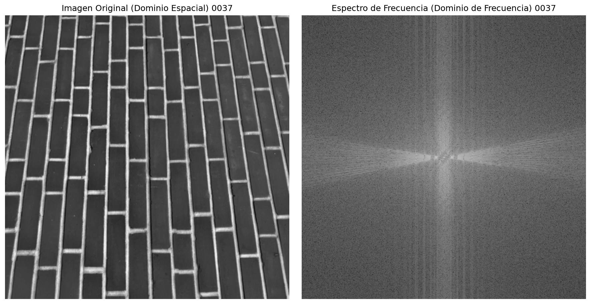
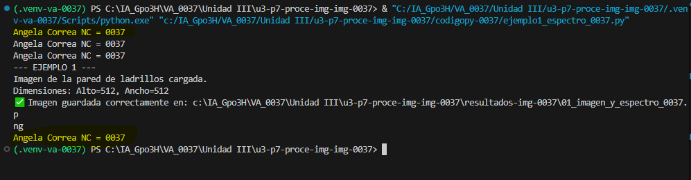
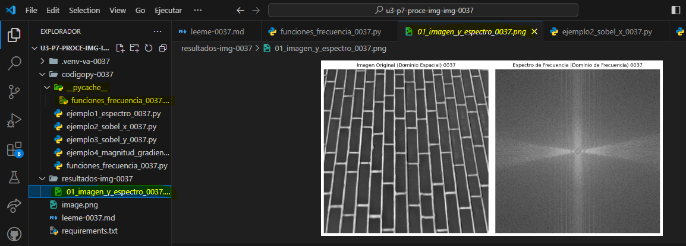
## 2. Resultado del ejemplo2_sobel_x_0037
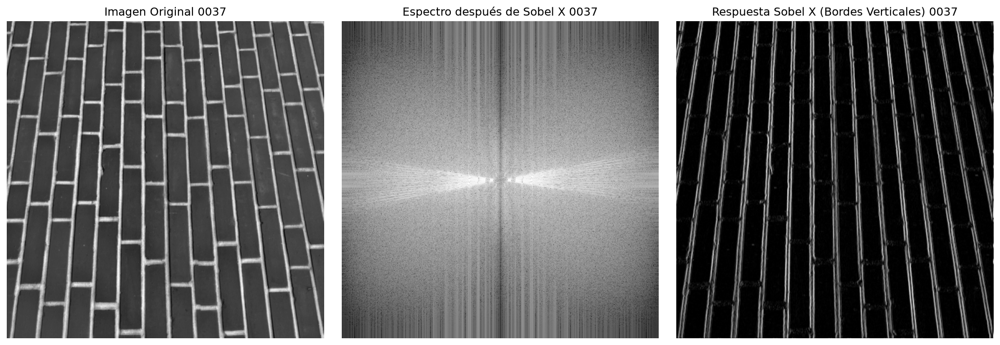

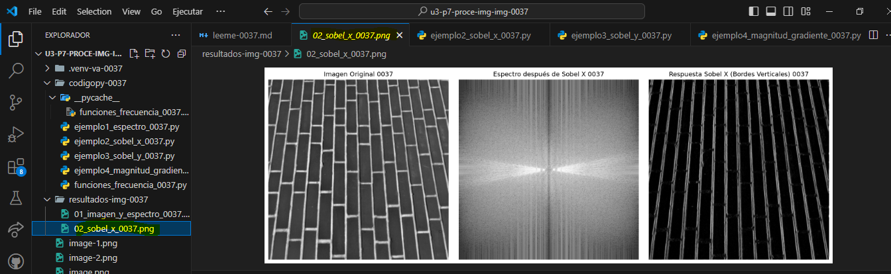
## 3. Resultado del ejemplo3_sobel_y_0037
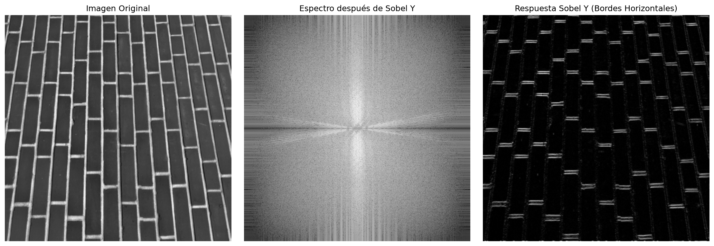
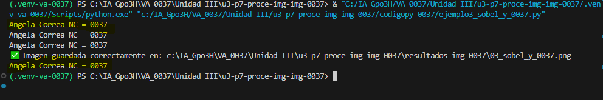
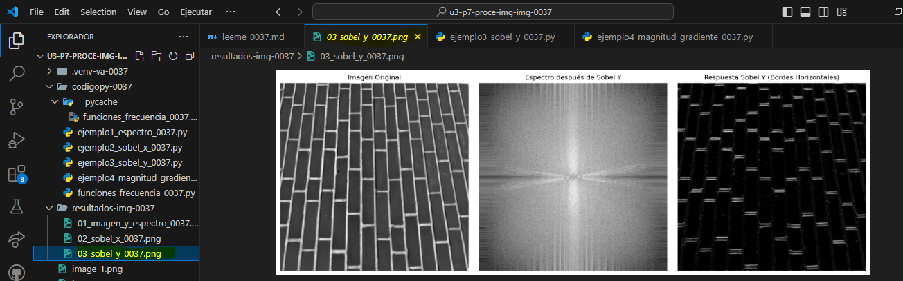
## 4. Resultado del ejemplo4_magnitud_gradiente_0037
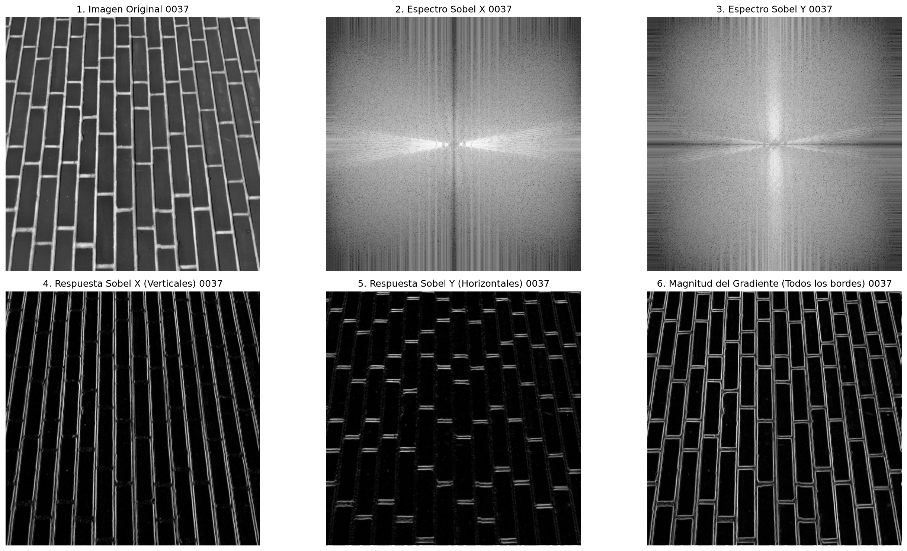
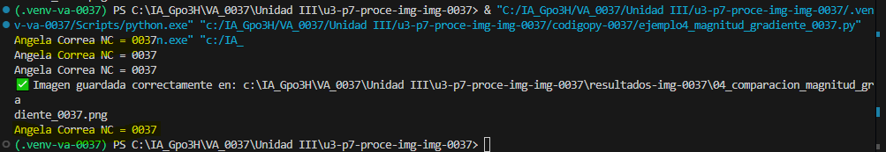
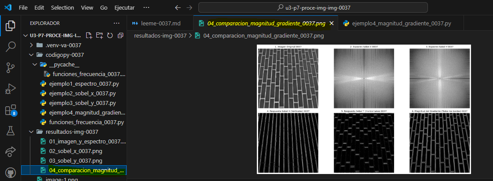